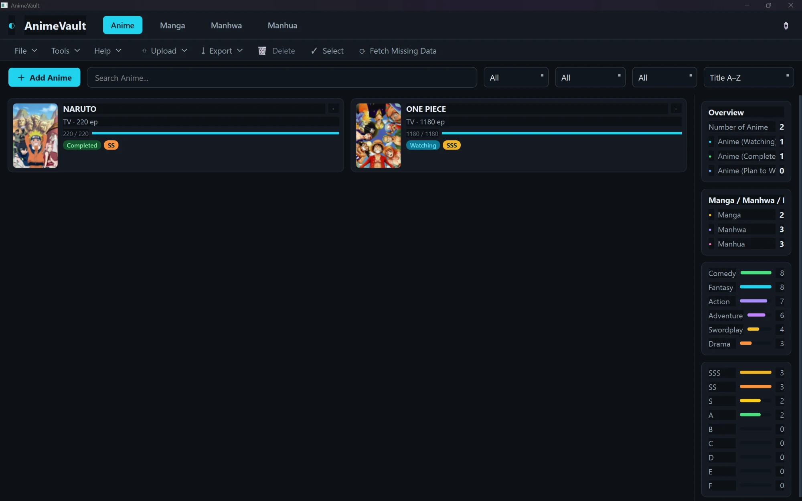
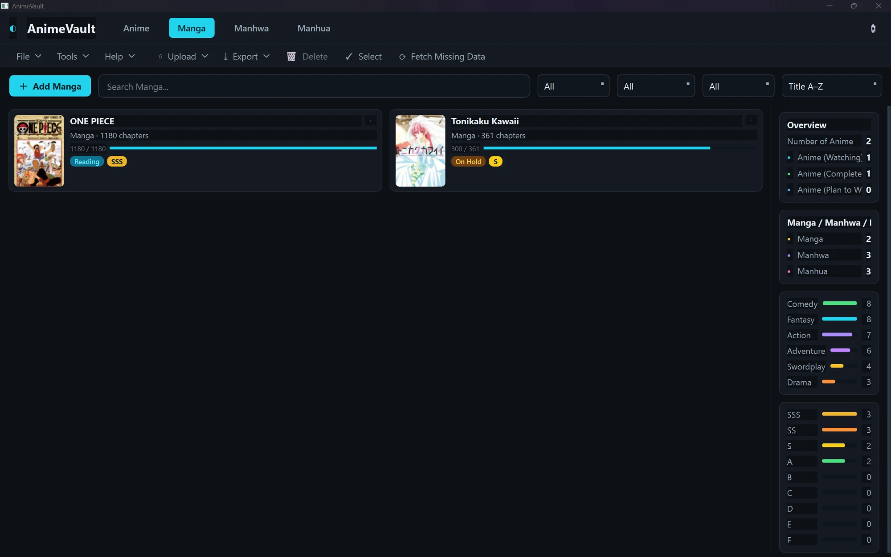
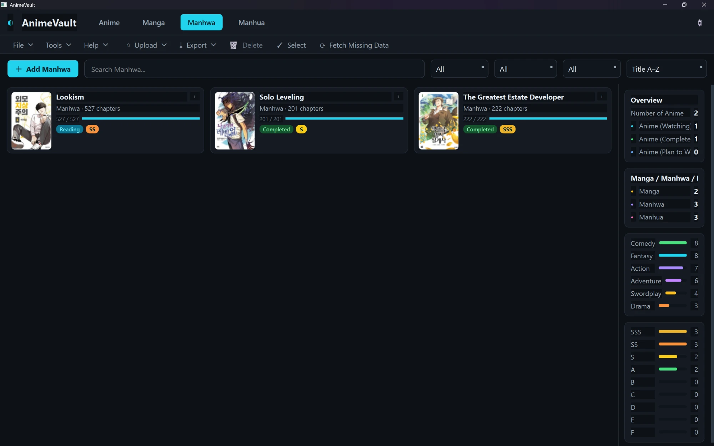
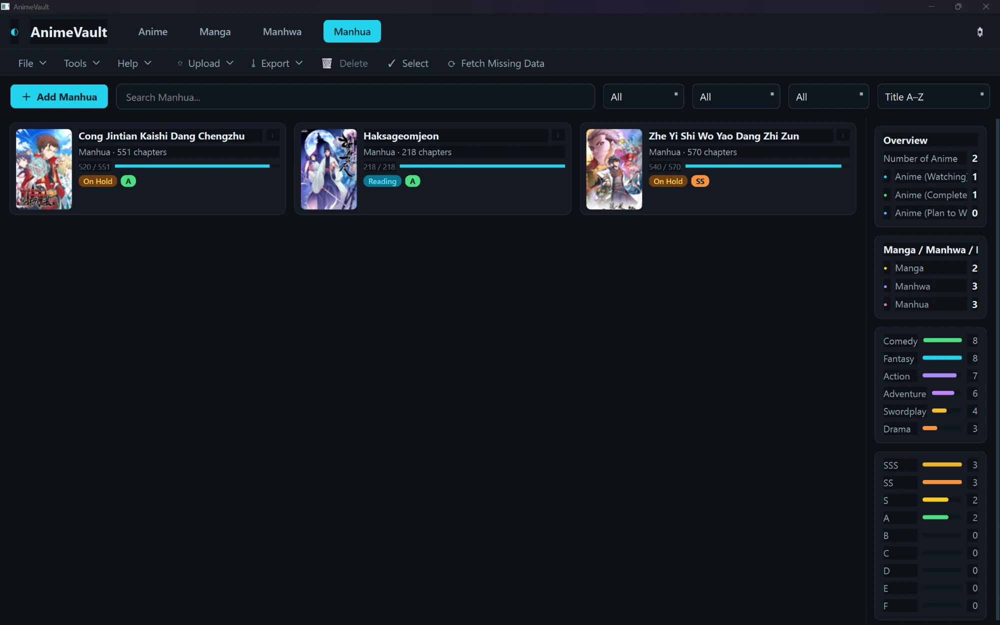
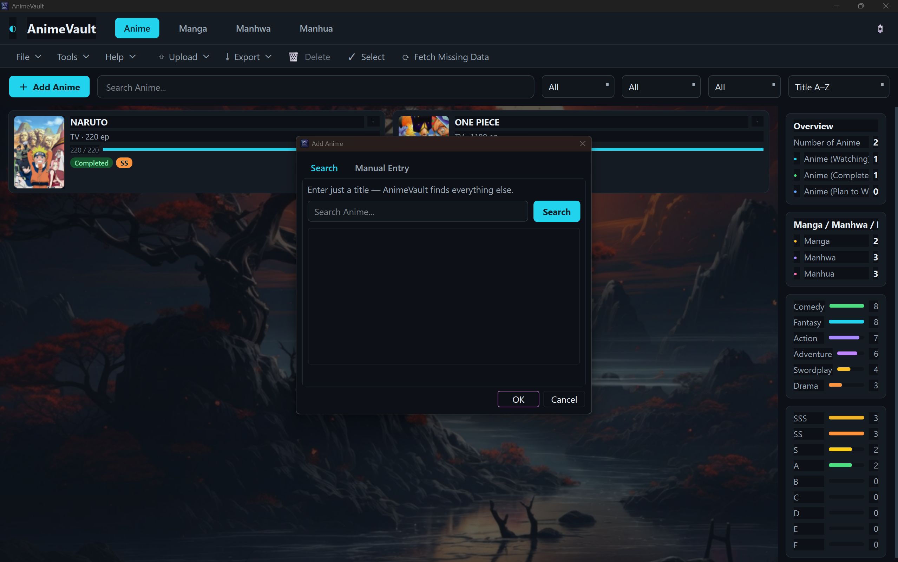
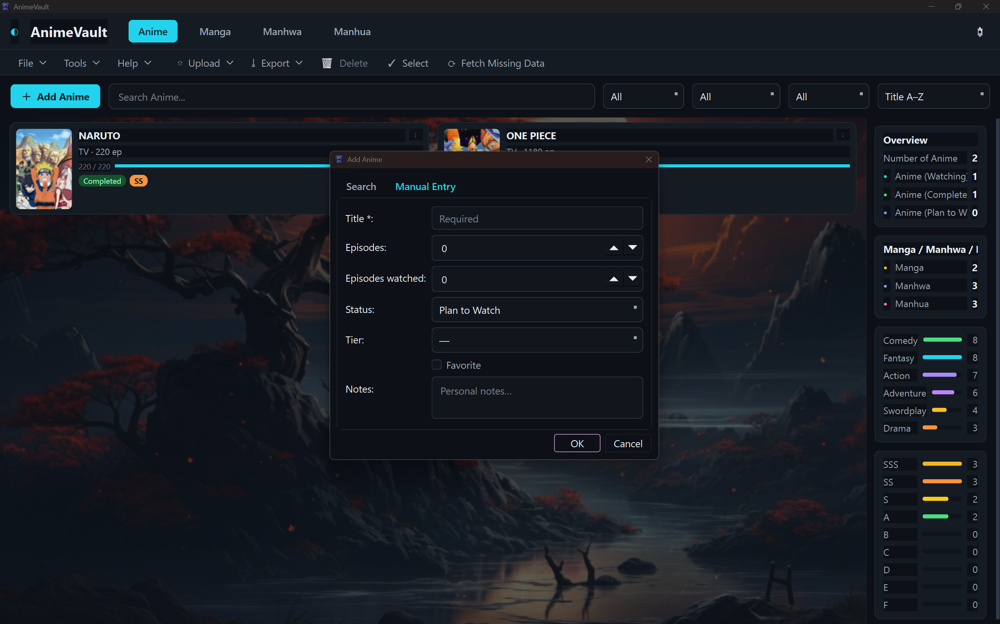

# AnimeVault

A cross-platform desktop library manager for **Anime, Manga, Manhwa and Manhua**, built with PySide6 and SQLite.

Enter a title — AnimeVault finds the rest: synopsis, episodes or chapters, genres, studio or authors, release dates, season, cover art and provider IDs.



## Screenshots

### Anime library

Poster-first cards with progress, status and tier badges, plus a live analytics sidebar.


### Manga and Manhwa

The same card system for literature — type is derived from provider data
(country of origin), not guessed from the title.

| Manga                           | Manhwa                            |
| ------------------------------- | --------------------------------- |
|  |  |

### Manhua



### Add by name only

The primary workflow needs just a title; metadata is fetched and merged automatically.
| AUTO ADD                                             | MANUAL ADD                                             |
| ---------------------------------------------------- | ------------------------------------------------------ |
|  |  |

## Features

**Library**
- Four media categories as first-class citizens (literature lives in its own tables, not bolted onto the anime table)
- Poster-first card grid that reflows with the window
- Search, filter (status / tier / type) and sort (title, tier, year, progress, …)
- Multi-select with a single confirmed delete
- Details view separating personal data from provider metadata

**Tier system**
- Personal ranking `SSS > SS > S > A > B > C > D > E > F`, never sorted alphabetically
- Optional AI (local Ollama) may normalise formatting, but never overrides authoritative provider data

**Metadata**
- Anime: Jikan, AniList, Kitsu, TMDB (key required; disabled without one)
- Literature: AniList (`countryOfOrigin` drives Manga/Manhwa/Manhwa detection)
- Caching with TTL, poster download with atomic writes, chunked background enrichment with cancellation

**Import / Export**
- Import **XLSX**, **CSV** and **SQL** dumps, with intelligent header recognition (`Anime Name`, `Watch Status`, `Episodes Seen`, `Rating Tier`, … all map correctly) and an explicit preview of mapped *and* unmapped columns
- Export the whole library to **CSV**, **XLSX**, **ODS**, or an application-compatible **SQL** dump. CSV/XLSX/ODS share a stable labeled column schema; spreadsheet exports include typed progress, Boolean, and date cells where supported. SQL preserves the app schema and its stored user/metadata fields; use **Back Up Database** for a byte-for-byte SQLite backup.
- CSV uses UTF-8 with BOM and proper quoting; XLSX has a frozen/filterable header row; ODS contains typed cells. Tabular exports include applicable identification, provider metadata, progress, personal fields, and poster paths/URLs.
- SQL imports are parsed and restored into a throwaway database first — never executed against the live one
- Existing personal data is never silently overwritten; the default merge policy is *only fill empty fields*

**Appearance and updates**
- The default Minimal Dark theme plus Midnight Blue, AMOLED Black, Light, Dracula, Nord, Anime Neon and Sakura; the selection is applied live and persisted in QSettings.
- Hide/Show Overview preserves the current library view and persists across restarts.
- Settings includes a non-silent update check. It only checks a configured public GitHub Releases API endpoint; enter the official `https://api.github.com/repos/OWNER/REPO/releases/latest` URL for the actual public repository.
- No trustworthy release source was verified in the repository at this time, so no owner/repository is prefilled. A 404, invalid endpoint or network failure is reported as an error, not as “up to date.” Installers are downloaded only after confirmation and are SHA-256 verified before launch.
- Enrichment reports metadata failures, legitimate no-match results and poster failures separately; it supports bounded retries, Retry-After, retrying failed library items, and exporting a sanitized JSON/CSV failure report.

## Requirements

- Windows 11 (also runs on macOS and Linux)
- Python 3.10+

## Development

```bash
# Create environment and install
python -m venv .venv
. .venv/Scripts/Activate.ps1   # PowerShell on Windows
# or: . .venv/bin/activate     # POSIX

pip install -e ".[dev]"

# Run the app
python -m animevault

# Run tests
pytest tests/ -v
```

### Running the tests

The suite is pure `pytest` and does not need a display:

```bash
pytest tests/ -q
```

## Project layout

```
src/animevault/
├── database.py          # SQLite connection + base schema
├── migration.py         # Versioned, additive, non-destructive migrations
├── tiers.py             # Canonical tier set and ordering
├── media_types.py       # Category / format / status vocabularies
├── models/              # anime.py, literature.py
├── services/
│   ├── providers/       # anilist, jikan, kitsu, tmdb, literature
│   ├── importers/       # xlsx, csv, sql + intelligent column mapping
│   ├── cache.py         # TTL response cache
│   ├── poster.py        # Poster download + validation
│   └── workers.py       # Background search + chunked enrichment
└── ui/                  # theme, cards, grid, dialogs, sidebar
```

## License

MIT