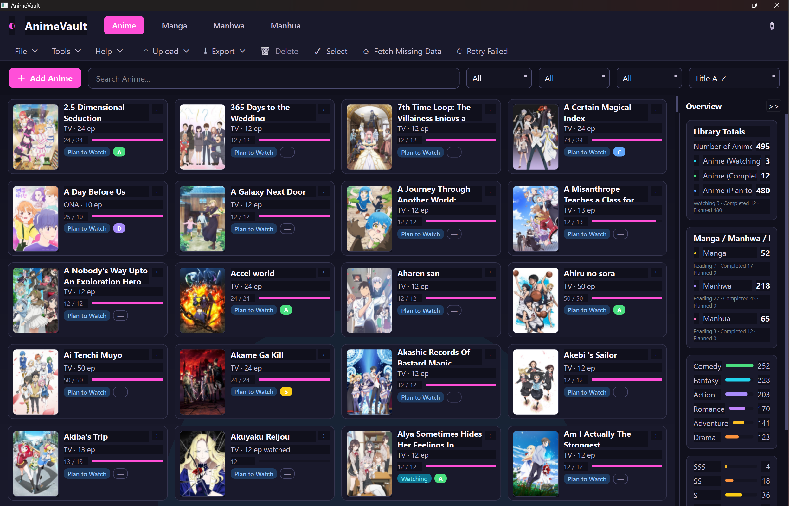
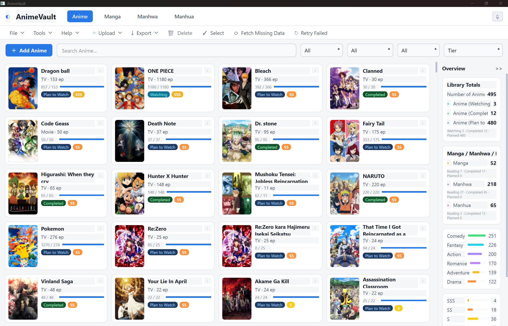
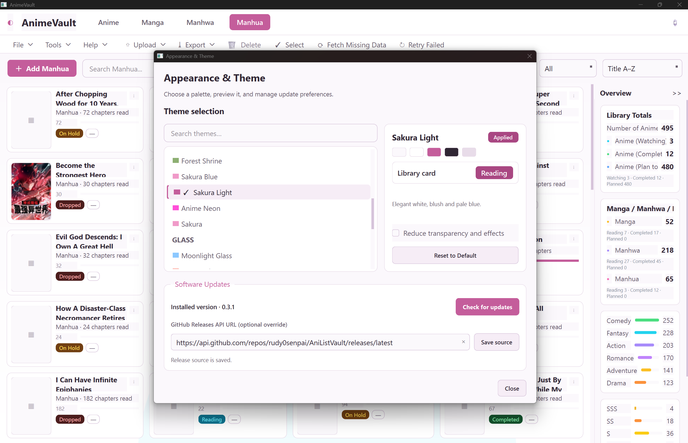
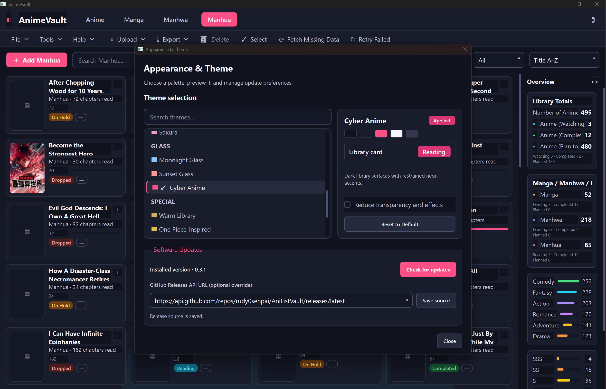
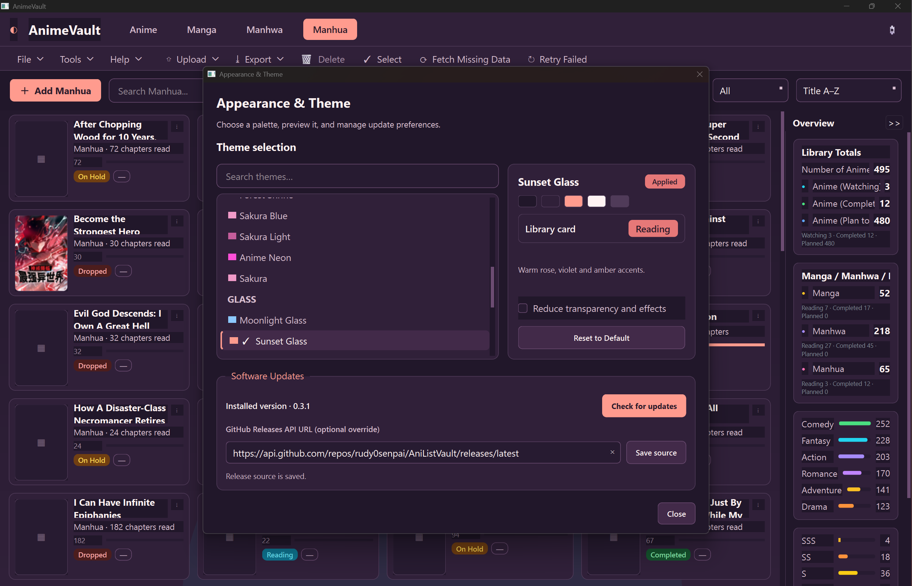
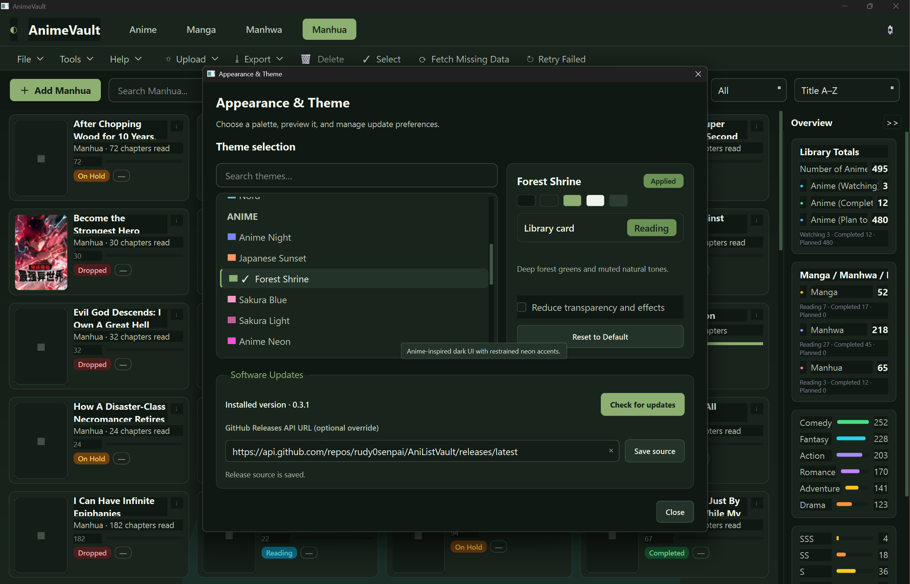
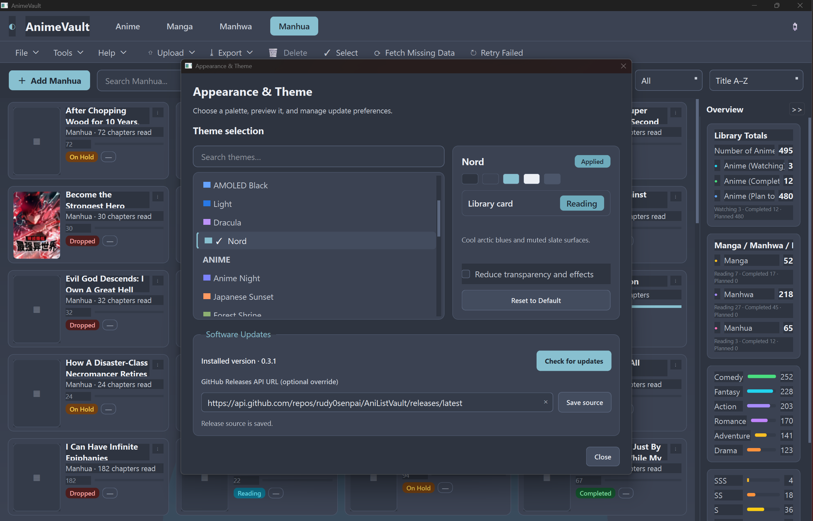
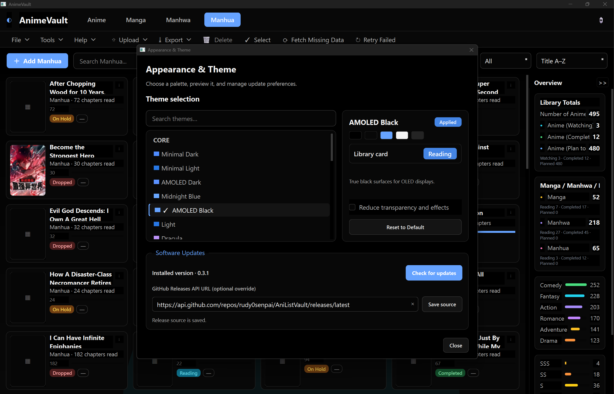
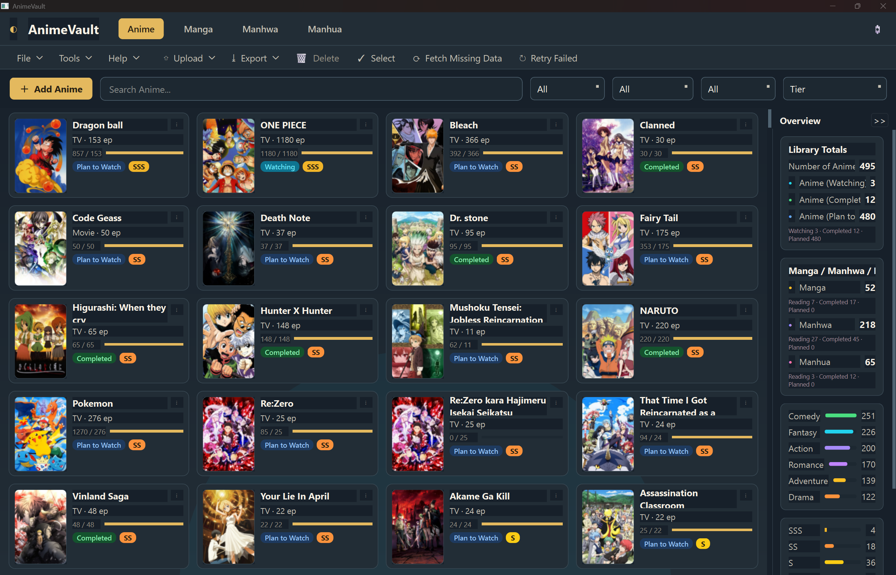
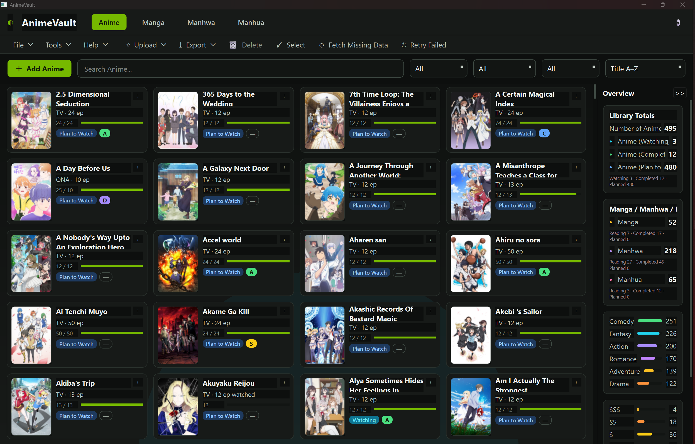

# AniListVault

**A desktop library manager for anime, manga, manhwa, and manhua.** Organize your collection, track episodes and chapters, add personal ratings, and enrich entries with metadata and cover art.

> The application window is currently branded **AnimeVault**; the repository and project are named **AniListVault**.

[Repository](https://github.com/rudy0senpai/AniListVault) · [Releases](https://github.com/rudy0senpai/AniListVault/releases)

## Screenshots

### Library and appearance

| Anime library · Anime Neon | Anime library · Light |
| --- | --- |
|  |  |

The screenshots below show the Appearance & Theme dialog and additional library palettes.

### Theme gallery

| Theme | Preview | Theme | Preview |
| --- | --- | --- | --- |
| Sakura Light |  | Cyber Anime |  |
| Sunset Glass |  | Forest Shrine |  |
| Nord |  | AMOLED Black |  |
| One Piece-inspired |  | NVIDIA green |  |

## Contents

- [Features](#features)
- [Installation](#installation)
- [Usage](#usage)
- [Metadata providers](#metadata-providers)
- [Technology](#technology)
- [Troubleshooting](#troubleshooting)
- [Development](#development)
- [License](#license)

## Features

- Separate Anime, Manga, Manhwa, and Manhua libraries, with card-based views and episode/chapter progress.
- Personal watch/read status and tier ratings (`SSS` through `F`); provider metadata is kept distinct from personal library fields.
- Search, filtering, sorting, multi-select, and a library overview with category, status, genre, and tier summaries.
- Metadata lookup, cover retrieval, caching, and background enrichment. Failed entries can be retried; no-match results and provider/poster failures are reported separately.
- Import CSV, XLSX, and SQL dumps; export CSV, XLSX, ODS, and application-compatible SQL. A separate database backup option is available in the application.
- Live theme selection, an option to reduce transparency/effects, and a persistent Overview panel setting.
- Optional software update checking against a configured GitHub Releases API endpoint. The application does not silently install updates.

## Installation

### Windows releases

Open the [GitHub Releases page](https://github.com/rudy0senpai/AniListVault/releases) and use an installer or other asset only if one is listed for the release. The repository contains a Windows packaging specification, but this README does not assume a particular release asset or installer filename.

### Run from source

Requires Python 3.10 or newer and PySide6 (installed from the project dependencies). From the repository root:

**Windows PowerShell**

```powershell
py -3 -m venv .venv
.\.venv\Scripts\Activate.ps1
python -m pip install -e ".[dev]"
python -m animevault
```

**macOS / Linux**

```bash
python3 -m venv .venv
. .venv/bin/activate
python -m pip install -e ".[dev]"
python -m animevault
```

The `animevault` console entry point is also defined by the project package.

## Usage

1. Launch the app with `python -m animevault` or the installed application entry point.
2. Choose the **Anime**, **Manga**, **Manhwa**, or **Manhua** tab. Use **Add** to create an entry; metadata lookup can start from a title, or you can enter details manually.
3. Open an entry's details or card controls to maintain personal status, progress, and tier/rating information.
4. Use the search box and filters/sort controls above the library to find and organize entries. The Overview panel summarizes the collection.
5. Use **Upload** to import supported files and **Export** to export the library. Review import mappings/preview before completing an import; use the dedicated database backup option for a full SQLite backup.
6. Open **Tools → Appearance & Theme** to search and preview palettes, apply one, and optionally reduce transparency/effects.
7. Use **Fetch Missing Data** to enrich incomplete entries and **Retry Failed** for previously failed items. The enrichment summary distinguishes provider errors, unmatched titles, and poster failures.
8. In Appearance & Theme, use **Check for updates** to query the configured public GitHub Releases API URL. The endpoint can be changed there; update downloads require confirmation.

Labels can vary slightly by application version.

## Metadata providers

- **Anime:** AniList, Jikan, and Kitsu are available through the provider layer. TMDB is optional and requires a configured API key; it is unavailable without one.
- **Manga, manhwa, and manhua:** AniList GraphQL is the primary search source. MangaDex and Kitsu are conditional fallback sources when AniList does not yield a reliable unique match.
- Literature candidates are checked using title variants and available metadata. Ambiguous or low-confidence candidates are left unresolved rather than automatically assigned. Provider availability, rate limits, and title coverage can affect results.
- Poster retrieval is separate from metadata matching; an entry can have metadata without a poster, or a poster request can fail independently.

No API keys or credentials are included in this repository documentation. TMDB use requires the user to configure a key in the application.

## Technology

- Python 3.10+
- PySide6 desktop UI
- SQLite local database
- Python standard-library HTTP/JSON networking for provider requests
- `pytest` for tests; setuptools via `pyproject.toml` for packaging

The project declares the MIT license in `pyproject.toml`. No standalone license file was found in the repository when this README was updated.

## Troubleshooting

- **No metadata match:** Check the spelling and title variant, then try adding the entry manually. Provider catalogs do not cover every title; ambiguous matches are intentionally not auto-selected.
- **Metadata lookup fails or is rate-limited:** Retry later. Provider outages, network errors, or rate limits can prevent lookup; repeated retries may not resolve missing catalog coverage.
- **Poster missing or download failed:** Retry enrichment later. Poster downloading is reported separately from metadata matching.
- **Import does not map a column as expected:** Review the import preview and mapped/unmapped columns before confirming. Check that the file is in a supported format (CSV, XLSX, or SQL dump).
- **Update check fails:** Verify the configured GitHub Releases API URL and network access. An invalid endpoint or network error is reported as an error, not as an up-to-date result.
- **Theme or settings issue:** Reopen Appearance & Theme and apply a palette again. Preferences are stored using Qt settings; resetting a theme is available in the theme preview.

## Development

```bash
python -m pip install -e ".[dev]"
pytest tests/ -q
```

The test suite uses pytest and is designed to run without opening the application UI. Contributions should keep changes focused, add or update tests for behavior changes, and avoid committing local databases, secrets, or generated build artifacts. No separate contribution guide was found in the repository.

## License

MIT, as declared in [`pyproject.toml`](pyproject.toml).
